  

# ⚖️ Awesome Standard Legal Template Management

  
  
  
  

> 📚 A curated list of top **Standard Legal Template Management platforms**, contract lifecycle management (CLM) solutions, open-source legal template repositories, and automated document assembly software for centralizing, composing, and governing reusable legal document templates.
> 
> 🌟 **Star this repo if you find it useful!** 🌟

---

## 📋 Table of Contents

- [📈 Sector Overview & Market Dynamics](#-sector-overview--market-dynamics)
- [🟦 SaaS / Hosted Platforms](#-saas--hosted-platforms)
- [🟩 Open-Source Software & Repositories](#-open-source-software--repositories)
- [📊 Comparison at a Glance](#-comparison-at-a-glance)
- [🤝 Contributing](#-contributing)
- [💖 Support](#-support)
- [⭐ Star History](#-star-history)
- [📄 License](#-license)

---

## 📈 Sector Overview & Market Dynamics

🌐 The global Contract Lifecycle Management (CLM) and Legal Document Automation sector is estimated at **$1.8 billion to $3.2 billion** and is projected to surpass **$3.6 billion+** over the next few years. 🧩 The market remains **moderately fragmented** with low overall vendor concentration—the top five providers account for only ~28%–35% of total market revenue across 150+ active vendors—allowing specialized vertical tools and niche clause-governance engines to thrive alongside consolidating enterprise suites.

---

## 🟦 SaaS / Hosted Platforms

💼 Commercial, cloud-hosted Standard Legal Template Management and CLM platforms, sorted descending by company scale (market capitalization / valuation / estimated ARR).

| 🏢 Product / Company | 💰 Company Scale (Valuation / Revenue) | 🏷️ Starting Price (Specific Tier) | ⏳ Free Tier / Trial Limits | 🚀 Key Features & Best For |
|---|---|---|---|---|
| **DocuSign Gen** | **~$14.5B–$15.4B** Market Cap (~$3.2B ARR) | **$20/user/month** (DocuSign Gen for Salesforce add-on; requires base eSignature plan from $10/user/mo or $40/user/mo Business Pro) | **30-day free trial**; capped by number of active connected eSignature seats with full document generation feature access | 📄 Salesforce-native document generation merging CRM records directly into standard Word/PDF agreements without code. |
| **Icertis Template Management** | **~$5.0B** Valuation (~$300M ARR) | **~$7,333/month** (~$88,000/year median ACV; enterprise quote-based tiers) | **No free tier; no public self-service trial** (custom private sales POC available upon request) | 🏢 Enterprise-grade CLM template governance deeply integrated with SAP S/4HANA and Salesforce for large global enterprises. |
| **Conga Composer** | **~$2.5B–$3.0B** Est. Valuation (~$400M ARR) | **~$35/user/month** (Salesforce AppExchange baseline; typical median contract ~$17,000/year) | **30-day free trial**; capped by user count and test transaction/merge document volume limits | 📑 High-volume data merging into Word, Excel, PowerPoint, and HTML email templates with complex business rules. |
| **Ironclad Workflow Designer** | **~$3.0B+** Valuation (~$200M ARR) | **~$4,166/month** (~$50,000/year starting mid-market deployment; quote-based) | **No free tier; no public self-service trial** (evaluation sandbox provided under sales evaluation agreement) | 🛠️ No-code template workflow builder with automatic Word markup strip-down, approval routing, and launch forms. |
| **PandaDoc Templates** | **~$1.0B** Unicorn Valuation (~$100M ARR) | **$19/seat/month** (billed annually) or $35/seat/month (billed monthly) for Starter plan | **Free forever plan** capped at **5 documents created via UI per month** (max 2 recipients); also offers a **14-day free trial** of Business plan | ✍️ Reusable document templates with role variables, content library clause blocks, e-signatures, and quote building. |
| **Agiloft Document Templates** | **~$600M–$800M+** Private Equity Valuation (~$60M–$70M ARR) | **~$5,000/month** (~$60,000/year average core CLM enterprise license; Astra AI starts at $120/month) | **No free trial for core CLM platform**; standalone Astra AI add-on offers a **free forever tier** with uncapped Word analysis | 🔍 CLM-integrated document generation utilizing Agiloft Contract Assistant for Word (.docx) tied to contract records. |
| **ContractPodAi** | **~$300M–$500M** Est. Valuation (~$47M–$58M ARR) | **~$4,166/month** (~$50,000/year starting entry tier with bundled unlimited user seats; quote-based) | **No free tier; no self-serve free trial** (custom proof-of-concept scheduled via sales demo) | 🌐 Enterprise legal platform with multilingual template libraries (e.g. Spanish LATAM), version comparison, and Leah AI. |
| **Formstack Documents** | **~$425M** Growth Round Scale (~$35M–$55M ARR) | **$250/month** (billed annually) or $299/month (billed monthly) for Suite plan | **14-day free trial** without credit card; no permanent free tier; accounts cap monthly document merges (250/month base) | 🔄 Multi-format template automation (Fillable PDF, Word, Excel) with conditional data routing across jurisdictions. |
| **Concord** | **~$40M–$60M** Est. Valuation (~$10M–$15M ARR) | **$499/month** (billed annually) for Essentials plan (includes 5 users; $49/mo per additional user) | **14-day free trial** with full feature access; no permanent free plan; paid tiers include unlimited documents and e-signatures | 📝 Word template conversion with integrated real-time redlining, public vs. private comments, and approval workflows. |

---

## 🟩 Open-Source Software & Repositories

🔓 Self-hosted, community-driven Legal Template Management tools, smart contract architectures, and standardized open legal libraries, sorted descending by GitHub Stars_Count.

- ### ⚖️ [General-Legal/legal-templates](https://github.com/General-Legal/legal-templates) 
  - **Stack:** Markdown / DOCX / Legal Engineering | **License:** CC0 1.0 Universal (Public Domain) 📜
  - **Overview:** High-quality, attorney-drafted standard legal templates tailored for tech startups and enterprises (NDAs, MSAs, DPAs, Offer Letters, Advisor Agreements). Optimized for human reading, Git versioning, and LLM automation.
  - **Best for:** Developers and legal teams looking for battle-tested, public-domain foundational agreement templates.

- ### 📚 [ankane/awesome-legal](https://github.com/ankane/awesome-legal) 
  - **Stack:** Markdown / Curated Index | **License:** CC0 1.0 Universal 📜
  - **Overview:** Curated directory of open, free standard legal documents, boilerplate contracts, investor docs (YC SAFE, NVCA), and terms of service templates.
  - **Best for:** Discovering reputable open-source legal documents across diverse business and compliance domains.

- ### 🧠 [Open-Source-Legal/OpenContracts](https://github.com/Open-Source-Legal/OpenContracts) 
  - **Stack:** Python (Django) / React / GraphQL / Docker | **License:** Apache-2.0 📜
  - **Overview:** An open-source, self-hosted document intelligence and contract management system (DMS) built for parsing, annotating, searching, and managing legal contracts with Model Context Protocol (MCP) support.
  - **Best for:** Self-hosted legal engineering, structured data extraction, and AI agent contract orchestration.

- ### 🤖 [jhpyle/docassemble](https://github.com/jhpyle/docassemble) 
  - **Stack:** Python / YAML / Markdown / Docker | **License:** MIT License 📜
  - **Overview:** Comprehensive expert system for guided web interviews and automated document assembly. Converts complex interview logic and question paths into finalized legal documents (.docx and PDF).
  - **Best for:** Automating dynamic legal intake questionnaires and template compilation for courts, clinics, and legal operations.

- ### 🏛️ [accordproject/template-archive](https://github.com/accordproject/template-archive) 
  - **Stack:** TypeScript / JavaScript / Concerto / Ergo | **License:** Apache-2.0 📜
  - **Overview:** Linux Foundation Accord Project repository housing computable legal templates and smart clauses that pair natural language prose with executable contract logic and data models.
  - **Best for:** Organizations building smart, computable legal contracts and automated clause validation.

- ### 💻 [stella/stella](https://github.com/stella/stella) 
  - **Stack:** TypeScript / Modern Web Stack | **License:** Apache-2.0 📜
  - **Overview:** Modern open-source legal workspace and document collaboration platform designed for legal practitioners.
  - **Best for:** Teams seeking a modern, self-hosted legal drafting and document workspace.

- ### 🤝 [CommonPaper/Mutual-NDA](https://github.com/CommonPaper/Mutual-NDA) 
  - **Stack:** Markdown / Standard Contract | **License:** CC BY 4.0 📜
  - **Overview:** Standard open-source Mutual Non-Disclosure Agreement created by an attorney committee, allowing rapid contracting with standard cover page variables.
  - **Best for:** Tech companies wanting friction-free, standardized confidentiality agreements.

- ### ☁️ [CommonPaper/CSA](https://github.com/CommonPaper/CSA) 
  - **Stack:** Markdown / Standard Contract | **License:** CC BY 4.0 📜
  - **Overview:** Standard Cloud Service Agreement (CSA) defining commercial terms for purchasing and providing SaaS software, designed to streamline B2B SaaS procurement.
  - **Best for:** SaaS startups seeking standard vendor/customer subscription contracts without extensive redlines.

- ### 🗄️ [template-vault](https://github.com/ishandutta2007/Awesome-Standard-Legal-Template-Management)
  - **Stack:** Python / Git | **License:** Open Source 📜
  - **Overview:** CLI tool storing legal templates as plain files in Git repositories with multi-user sync (`git pull`/`push`). Features clause composition via `clause_overrides` and provenance tracking.
  - **Best for:** Legal ops teams and developers wanting Git-native template management with clause-level composition.

- ### 📑 [contract-vault](https://github.com/ishandutta2007/Awesome-Standard-Legal-Template-Management)
  - **Stack:** Python / Git | **License:** Open Source 📜
  - **Overview:** Post-signature Git-backed vault managing executed contracts, key dates, auto-renewals, and obligations with field-level provenance tracking.
  - **Best for:** Tracking post-execution obligations, renewal milestones, and ICS calendar exports.

- ### 🧞 [Genie AI](https://genieai.co)
  - **Stack:** Web Platform / AI | **License:** Community Free Tier / Open Model 📜
  - **Overview:** Community-focused legal library utilizing generative AI and open legal data to assist startups and small businesses in drafting standard contracts.
  - **Best for:** Startups looking for free-tier AI contract drafting assistance across common legal documents.

---

## 📊 Comparison at a Glance

| 🛠️ Software | 📜 License | 💻 Stack | 📑 Template Library | 🧩 Clause Composition | 🔍 Provenance Tracking | 🏠 Self-Hosted | 🎯 Best For |
|---|---|---|---|---|---|---|---|
| **DocuSign Gen** | Proprietary | Salesforce / Cloud | ✅ Merge fields | ❌ | ❌ | ❌ | Salesforce-native contract generation |
| **Icertis** | Proprietary | Cloud / Enterprise | ✅ Governance rules | ❌ (Workflow) | (Enterprise audit) | ❌ | SAP/Salesforce enterprise template governance |
| **Conga Composer** | Proprietary | Salesforce / Multi-tenant | ✅ Multi-format | ❌ (Merge logic) | ❌ | ❌ | High-volume multi-channel document assembly |
| **Ironclad** | Proprietary | Cloud | ✅ Upload + tag | ❌ (Workflow) | (Audit trail) | ❌ | Workflow-driven template governance |
| **PandaDoc** | Proprietary | Cloud | ✅ Gallery + upload | ❌ (Variables) | ❌ | ❌ | Branded reusable templates & e-signatures |
| **Agiloft** | Proprietary | Cloud / Hybrid | ✅ Word Assistant | ❌ | ❌ | (Hybrid/On-prem) | CLM-integrated document generation |
| **ContractPodAi** | Proprietary | Cloud | ✅ Multilingual | ❌ | (Version history) | ❌ | Global enterprise CLM with Leah AI |
| **Formstack Docs** | Proprietary | Cloud | ✅ Multi-format | ❌ (Routing) | ❌ | ❌ | Conditional jurisdictional template routing |
| **Concord** | Proprietary | Cloud | ✅ Word conversion | ❌ (Track changes) | (Version history) | ❌ | Integrated negotiation, redlining & eSign |
| **General-Legal** | CC0 1.0 | Markdown / DOCX | ✅ Attorney library | ✅ Modular clauses | ✅ Git history | ✅ Local/Self-hosted | Public-domain standard startup agreements |
| **OpenContracts** | Apache-2.0 | Python / React | ✅ Dynamic docs | ✅ AI Annotations | ✅ Audit graph | ✅ Self-hosted | Self-hosted document intelligence & DMS |
| **Docassemble** | MIT | Python / YAML | ✅ Guided assembly | ✅ Dynamic logic | ✅ Source code | ✅ Self-hosted | Dynamic interviews & automated document drafting |
| **Accord Project** | Apache-2.0 | TypeScript / Concerto | ✅ Smart archive | ✅ Executable logic | ✅ Git history | ✅ Self-hosted | Computable legal templates & smart clauses |
| **template-vault** | Open Source | Python / Git | ✅ Git-backed | ✅ Clause swap | ✅ `clause_overrides` | ✅ Self-hosted | Git-native clause composition & provenance |
| **contract-vault** | Open Source | Python / Git | (Post-signature) | ❌ | ✅ Field-level source | ✅ Self-hosted | Executed contract & obligation tracking |

---

## 🤝 Contributing

🙌 Contributions are welcome! If you know of an open-source or notable Standard Legal Template Management tool, legal technology repository, or open contract library that should be listed here:

1. 🍴 Fork this repository.
2. ➕ Add your tool to the relevant section (maintain descending sorting).
3. 🔍 Ensure the project is active and accurately described.
4. 🚀 Submit a Pull Request with a short summary of why the tool stands out.

---

## 💖 Support

✨ Thank you for using and exploring this repository! If you find this curated collection helpful for your legal engineering, contract automation, or legal operations workflows, please consider supporting the project:

- ⭐ **Star this repository** on GitHub to show your support!
- 🍴 **Fork and share** it with fellow developers, legal ops teams, and legal engineers.
- 📢 **Spread the word** on LinkedIn, Twitter/X, and tech communities.
- ☕ **Buy me a coffee / Sponsor:** You can support ongoing maintenance and new tools via the [GitHub Sponsors Dashboard](https://github.com/sponsors/ishandutta2007).

---

## 📈 Star History

---

## 📄 License

This curated list is released under [CC0 1.0 Universal (Public Domain)](https://creativecommons.org/publicdomain/zero/1.0/). Individual software projects, platforms, and repositories retain their respective licenses.

---

⭐ **If this repository helps streamline your legal operations, please star it!** ⭐
